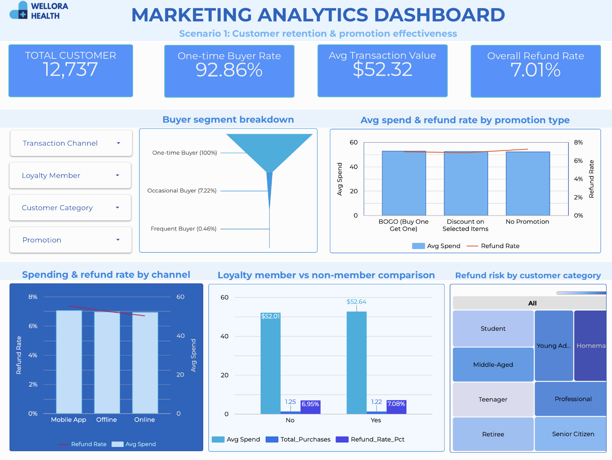
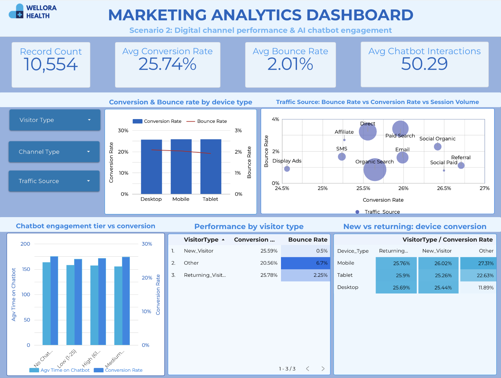
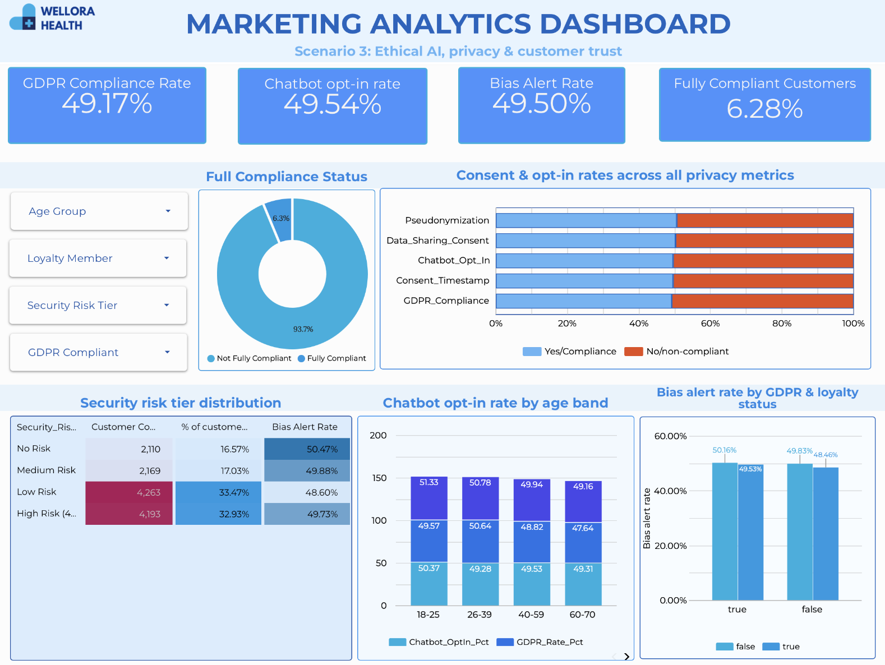

<div align="center">


# Wellora Health Marketing Analytics

**Customer retention, digital performance and ethical AI analytics for an omnichannel health and wellness retailer**

[](https://cloud.google.com/bigquery)
[](https://datastudio.google.com/reporting/d69c5298-75fa-414d-b454-4d3cee7fa0b2)

[Overview](#overview) • [Key findings](#key-findings) • [Recommendations](#recommendations) • [Dashboards](#dashboards) • [Reproduce the analysis](#reproduce-the-analysis) • [Project structure](#project-structure)

</div>

---

## Overview

Wellora Health is a fictional omnichannel health and wellness retailer selling through a mobile app, online and in store. Customer lifetime value is falling, repeat purchases are weak, digital channels perform unevenly, and there are gaps in data privacy and algorithmic governance.

This project diagnoses those problems with **BigQuery SQL**, visualises them in **Looker Studio** dashboards, and turns the results into evidence-based marketing recommendations. It covers three linked case studies:

| # | Case study | Business question |
|---|---|---|
| 1 | **Customer retention & promotion effectiveness** | How do spend and refunds differ across channels, categories and promotions, and do loyalty members actually buy more often? |
| 2 | **Digital channel & AI chatbot performance** | How does performance vary by device, traffic source and visitor type, and does chatbot engagement drive conversion? |
| 3 | **Ethical AI, privacy & customer trust** | How many customers have valid consent and GDPR compliance, and what do bias alerts and unauthorised access attempts reveal about governance? |

> [!NOTE]
> Completed for MIS384 at Deakin University. Wellora Health is a fictional company.

### Data

| Dataset | Grain | Size |
|---|---|---|
| `Customer_Transaction_2026` | One row per transaction | 13,921 records |
| `Customer_Profile_2026` | One row per customer (loyalty, consent, GDPR, bias and security fields) | 12,735 records |
| `Webpage_Performance_2026` | One row per web session (bounce, exit, conversion, chatbot usage) | 10,554 sessions, 19 variables |

Data preparation included standardising null promotions as `No Promotion`, generating surrogate IDs for missing transaction IDs, deriving a binary refund flag, decoding numeric traffic-source codes, and engineering buyer segments, chatbot engagement tiers, security risk tiers and a full-compliance flag.

## Key findings

**The loyalty program doesn't change how often people buy.** Members and non-members both average **1.09 purchases per customer**. Members spend slightly more ($52.64 vs $52.01) but don't return more often. The real question is less "are members happy?" and more "is spend the right currency for loyalty at all?"

**Retention is the biggest revenue gap.** **92.86%** of customers are one-time buyers. Frequent buyers (4+ purchases) are only 0.43% of the base, but their average lifetime spend ($267.71) is more than **5×** a one-time buyer's ($52.22).

**BOGO is the strongest promotion.** It has the highest average spend ($52.61) and the lowest refund rate (6.95%) of any promotion type.

**Paid Search underperforms and Referral is the most efficient channel.** Referral converts best (**26.71%**) with a 1.10% bounce rate. Paid Search has high bounce (3.39%) and exit (5.74%) rates with only moderate conversion.

**The chatbot supports customers but doesn't drive sales.** About 99% of sessions use it, but conversion peaks at *medium* engagement (26–60 interactions, 26.05%) instead of rising with more use.

**Privacy and bias problems come from how the system is built, not from customer behaviour.** GDPR compliance (49.17%), chatbot opt-in (49.54%) and data-sharing consent (50.21%) all sit near 50/50, and only **6.28%** of customers meet all four privacy conditions. Bias alert rates are just as uniform (48.46–50.16%) whatever a customer's GDPR or loyalty status, and consent rates barely change across age bands.

> [!IMPORTANT]
> The three case studies are causally linked. Invalid consent (case study 3) blocks the personalised communication needed to fix retention (case study 1) and optimise the chatbot (case study 2), so governance is a prerequisite for the other fixes, not a side issue.

## Recommendations

| Area | Recommendation |
|---|---|
| Retention | Run an automated three-stage post-purchase sequence for first-time buyers: a personalised recommendation within 48 hours, a BOGO offer on day 14, and a re-engagement prompt on days 21–30. |
| Loyalty | Rebuild the program around purchase-count tiers (Starter / Wellness Member / Wellora Elite) instead of spend. Moving just 5% of one-time buyers to repeat buyers is worth an estimated **~$38,500** in extra revenue. |
| Acquisition | Build campaign-specific landing pages for Paid Search and move underperforming budget to Referral partnerships. |
| AI chatbot | Make the chatbot a proactive conversion tool, with product nudges and cart-completion prompts at the medium-engagement threshold, and set up a no-chatbot A/B control to measure ROI. |
| Privacy | Deploy a Consent Management Platform with granular, purpose-specific opt-in flows (GDPR Art. 4(11) and 7) and record consent timestamps, filling the 6,426 consent-timestamp records currently missing. |
| AI governance | Commission an independent algorithmic bias audit, set a formal bias-alert threshold (≤5% per segment), and report against it every quarter. |

**Next step:** build a predictive customer lifetime value model in BigQuery ML, trained on purchase frequency, basket size, channel preference and promotion response, to move from describing segments to scoring customers and allocating retention spend.

## Dashboards

Explore the interactive version on **[Looker Studio](https://datastudio.google.com/reporting/d69c5298-75fa-414d-b454-4d3cee7fa0b2)**.

<details open>
<summary><b>Scenario 1: Customer retention & promotion effectiveness</b></summary>



</details>

<details>
<summary><b>Scenario 2: Digital channel performance & AI chatbot engagement</b></summary>



</details>

<details>
<summary><b>Scenario 3: Ethical AI, privacy & customer trust</b></summary>



</details>

## Reproduce the analysis

### Prerequisites

- A [Google Cloud](https://cloud.google.com/) project with BigQuery enabled (the free sandbox tier is enough)
- The three source tables loaded into a dataset named `MIS384_A3` as `Customer_Transaction`, `Customer_Profile` and `Webpage_Performance`

> [!NOTE]
> The raw datasets were supplied as course material and are not included in this repository.

### Steps

1. Clone the repository:

   ```bash
   git clone https://github.com/ashlynn-05/Wellora_Marketing-Analytics.git
   cd Wellora_Marketing-Analytics
   ```

2. Replace the placeholder project ID in every script with your own:

   ```bash
   sed -i 's/your-project-id/<YOUR_GCP_PROJECT_ID>/g' sql/*.sql
   ```

3. In the BigQuery console, run the scripts in order:

   | Script | What it does |
   |---|---|
   | [`00_data_preparation.sql`](sql/00_data_preparation.sql) | Cleans the transaction and customer profile tables |
   | [`01_scenario1_customer_retention.sql`](sql/01_scenario1_customer_retention.sql) | Builds `S1_Customer_Retention_Analysis` and runs channel, promotion, loyalty, buyer-segment and category queries |
   | [`02_scenario2_digital_performance.sql`](sql/02_scenario2_digital_performance.sql) | Builds `S2_Digital_Performance_Analysis` and runs device, traffic-source, visitor-type and chatbot-tier queries |
   | [`03_scenario3_privacy_ethics.sql`](sql/03_scenario3_privacy_ethics.sql) | Builds `S3_Privacy_Ethics_Analysis` and runs consent, security-risk, bias and age-band queries |

4. Connect Looker Studio to the `S1_`, `S2_` and `S3_` analysis tables to rebuild the dashboards.

> [!TIP]
> Each script starts with a `CREATE OR REPLACE TABLE` statement followed by standalone `SELECT` queries. Run the table build first, then highlight and run each query on its own to see its results.

## Project structure

```text
.
├── assets/                                  # Logo and dashboard screenshots
├── sql/
│   ├── 00_data_preparation.sql              # Cleaning: transactions and customer profiles
│   ├── 01_scenario1_customer_retention.sql  # Retention, promotions, loyalty, buyer segments
│   ├── 02_scenario2_digital_performance.sql # Device, traffic source, visitor type, chatbot tiers
│   └── 03_scenario3_privacy_ethics.sql      # Consent, GDPR, security risk, algorithmic bias
└── README.md
```

## Skills demonstrated

- **SQL & data preparation:** BigQuery, CTEs, window functions, `UNPIVOT`, conditional aggregation, feature engineering
- **Customer analytics:** buyer segmentation, loyalty cohort comparison, promotion and refund analysis
- **Digital analytics:** funnel metrics (bounce, exit, conversion) by device, traffic source and visitor type; chatbot engagement tiering
- **Privacy & governance:** consent and GDPR compliance audit, security risk tiering, algorithmic bias analysis
- **Visualisation & storytelling:** Looker Studio dashboards and stakeholder-ready recommendations grounded in customer lifecycle marketing

---

<div align="center">

Built by **Lynn Le** · Marketing Analytics

</div>
